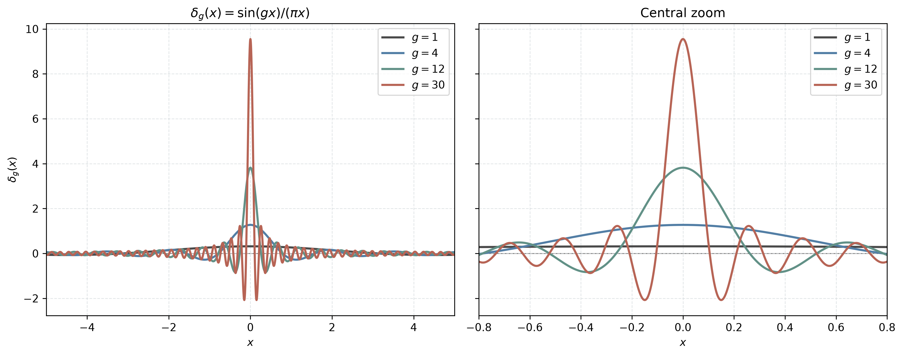

# HW3 Problem 5(a): a sinc delta sequence



For a positive cutoff g, consider

\[
\delta_g(x)=\frac{\sin(gx)}{\pi x},\qquad
\delta_g(0)=\frac{g}{\pi}.
\]

The expression at zero is defined by continuity. The script uses NumPy's
normalized sinc function to evaluate it without division by zero.

As g increases:

- the central peak height g/π increases;
- the first zeros ±π/g move inward, giving a central width 2π/g;
- the oscillations become more rapid, with positive and negative side lobes.

The full view shows the oscillations; the central zoom makes the changes in
height and width easier to compare. Both panels use the same vertical scale.
The product gx is dimensionless. If x represents a length, g has inverse-length
units and δ_g has inverse-length units.

## Interpreting the limit

For g > 0, the signed integral over the whole real line is 1. This integral
is conditionally convergent; the plotted finite interval need not have area 1.
For a symmetric window [-L, L], its signed area is (2/π) Si(gL).

At a fixed nonzero x, δ_g(x) generally keeps oscillating as g increases.
The convergence to the Dirac delta is understood through integration against
suitable smooth test functions, rather than ordinary pointwise convergence.
For example,

\[
\int_{-\infty}^{\infty}e^{-x^2}\delta_g(x)\,dx
=\operatorname{erf}(g/2)\longrightarrow 1.
\]

## Run

```bash
uv run python delta_sequence.py
uv run python delta_sequence.py --g 1 4 12 30 --show
```

The script saves `figs/delta_sequence.png` and `figs/delta_sequence.svg`.
The positive cutoff values can be changed with `--g`; the two view widths
are defined near the top of the script. Custom runs overwrite the same
output files.
