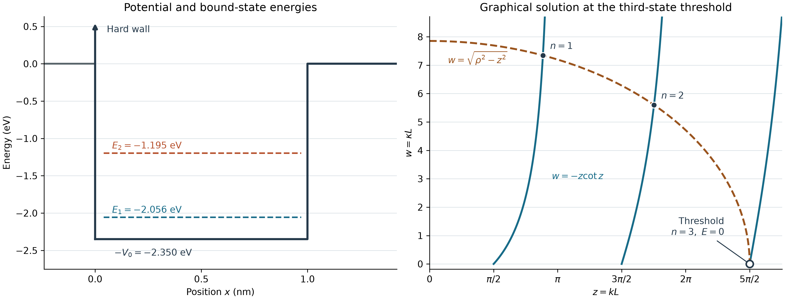
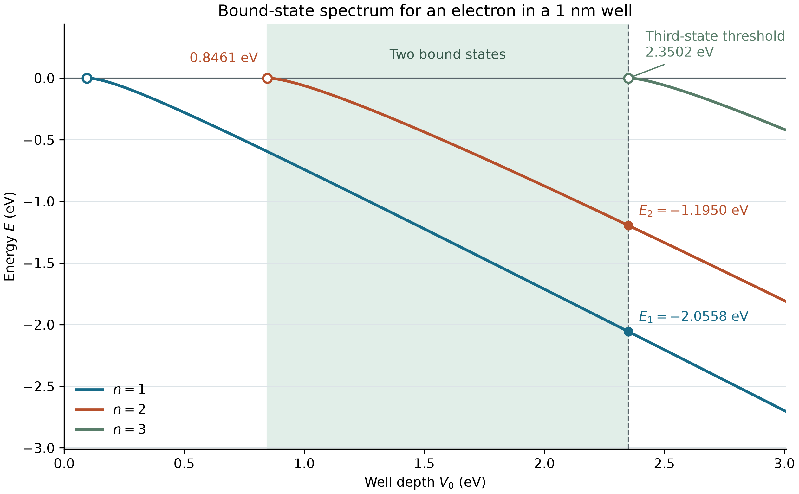
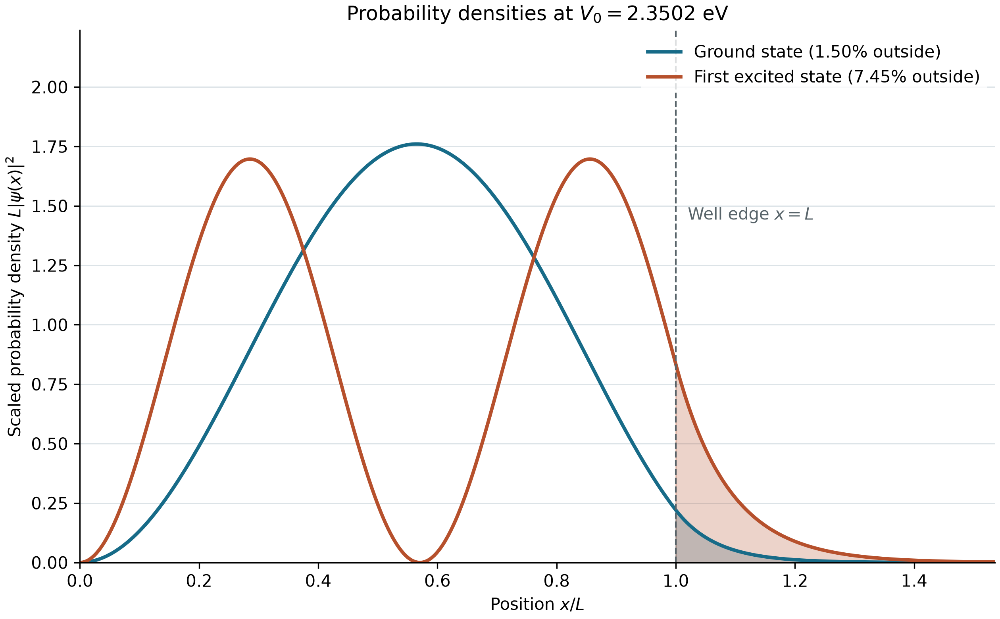

# HW4 Problem 4(a–c,f) — One-sided finite well

The well has a hard wall at $x=0$, potential $-V_0$ for $0<x<L$, and
zero potential for $x>L$. A bound state has $-V_0<E<0$. For a particle
of mass $m$, use the energy scale $E_\ast=\hbar^2/(2mL^2)$ and define

```math
z=kL=\sqrt{(V_0+E)/E_\ast},\qquad
w=\kappa L=\sqrt{-E/E_\ast},\qquad
\rho=\sqrt{V_0/E_\ast}.
```

The hard-wall condition selects $\sin(kx)$ inside the well. Matching
it and its derivative to the exponential tail at $x=L$ gives
$w=-z\cot z$, with $z^2+w^2=\rho^2$.

## (a) Graphical matching at a fixed depth



The left panel shows the potential energy as a function of position, with
a hard wall at $x=0$ and a step from $-V_0$ to $0$ at $x=L$. Both panels use
the depth for which the third state reaches the threshold, $\rho=5\pi/2$.

In the right panel, the horizontal axis is $z=kL$ and the vertical axis is
$w=\kappa L$. The blue curves show the branches of $w=-z\cot z$ allowed
for $w\ge 0$. The dashed quarter-circle $w=\sqrt{\rho^2-z^2}$ gives the
relation between $z$ and $w$ at this depth. Each intersection satisfies
both conditions. The two filled points have $w>0$ and give bound-state
energies $E=-E_\ast w^2$. The open point has $w=0$ and $E=0$.

## (b,c) Binding thresholds and energies



On branch $n=1,2,\ldots$, the bound-state root lies between
$z_{\mathrm{th},n}=(n-\tfrac12)\pi$ and $n\pi$. With
$z=z_{\mathrm{th},n}+\theta$, the matching condition gives
$z=\rho\cos\theta$ and $w=\rho\sin\theta$. Solving
$z_{\mathrm{th},n}+\theta=\rho\cos\theta$ on $0<\theta<\pi/2$
gives the energy $E_n=-E_\ast w^2$.

Each branch starts at the depth $V_{\mathrm{th},n}=E_\ast z_{\mathrm{th},n}^2$.
At that depth $E=0$ and the exterior solution is a nonzero constant, so its
norm diverges. This is why the spectrum marks the thresholds with open circles
and why exactly two bound states exist for
$V_{\mathrm{th},2}<V_0\le V_{\mathrm{th},3}$.

In the spectrum, the horizontal axis is the well depth $V_0$. Choose a
depth and follow a vertical line to read the energies where it crosses
the curves below $E=0$. For an electron with $L=1\,\mathrm{nm}$, the shaded
two-state interval runs from $0.84607\,\mathrm{eV}$ to $2.35019\,\mathrm{eV}$.
At the marked depth $V_0=2.35019\,\mathrm{eV}$, the vertical line crosses
two bound-state energies, $-2.05578\,\mathrm{eV}$ and $-1.19504\,\mathrm{eV}$.

## (f) Probability outside the well



With $y=x/L$, write the normalized state as $\psi(x)=A_n\sin(z_n y)$
inside and $\psi(x)=A_n\sin z_n\,e^{-w_n(y-1)}$ outside.
Using the matching condition in the normalization integral gives
$LA_n^2=2w_n/(1+w_n)$. The plot shades the tails of $L|\psi(x)|^2$
for $y>1$. Integrating each tail to infinity gives the outside probability.

```math
P_{\mathrm{out},n}
=\int_1^\infty LA_n^2\sin^2 z_n\,e^{-2w_n(y-1)}\,dy
=\frac{\sin^2 z_n}{1+w_n}.
```

| State at $V_0=V_{\mathrm{th},3}$ | Outside probability |
| --- | ---: |
| Ground state | 1.50% |
| First excited state | 7.45% |

The first excited state is closer to $E=0$, so its smaller $w$ produces
a more slowly decaying tail. Its density is also larger at the well edge.

## Run

```bash
uv run python one_sided_finite_well.py
```

The script saves the matching, spectrum, and density figures as PNG and SVG
files in `figs/`.
Add `--show` to open the plot windows.
