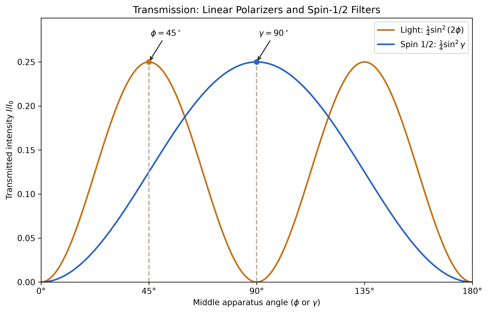
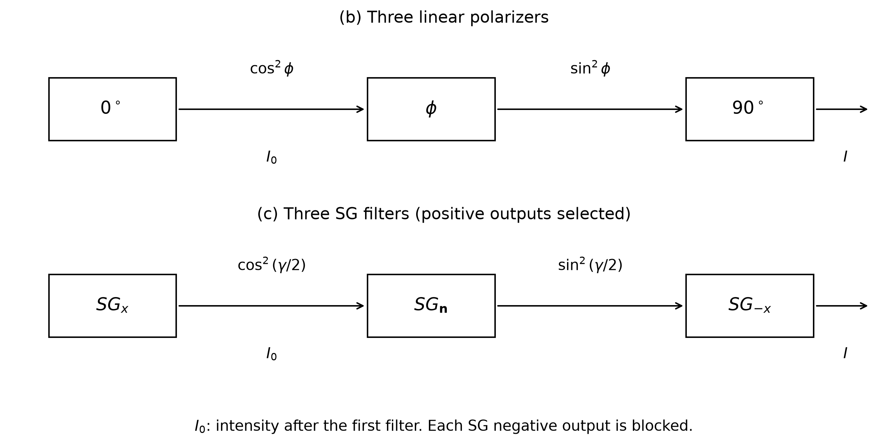

# HW3: three polarizers and three Stern-Gerlach filters



In both experiments, **I₀ is the intensity after the first filter**.
The graph therefore gives the fraction of this already prepared beam
that survives the remaining two devices. It does not include the loss
at the first device.

## (b) Linear polarization

The first polarizer has transmission axis 0°, the middle one φ, and the
last one 90°. Malus's law gives the two successive transmission factors:

\[
\frac{I}{I_0}
=\cos^2\phi\,\cos^2(90^\circ-\phi)
=\cos^2\phi\,\sin^2\phi
=\frac14\sin^2(2\phi).
\]

Between the first and final axes (0° ≤ φ ≤ 90°), the optimum is φ = 45°,
giving I/I₀ = 1/4. Continuing the middle polarizer to 180° also produces a
maximum at 135°. A linear polarization axis
has no arrow: rotating it by 180° describes the same polarizer.

## (c) Spin 1/2

The first device selects |Sₓ;+⟩. The middle measurement axis is
n = cos γ x̂ + sin γ ŷ; the last device selects |S₋ₓ;+⟩.
**Each SG device blocks its negative output.**

The angle between the middle and final axes is π − γ for 0 ≤ γ ≤ π.
The spin-1/2 overlap rule gives:

\[
P_1=\cos^2\frac\gamma2,\qquad
P_{2\mid1}=\cos^2\frac{\pi-\gamma}{2}
=\sin^2\frac\gamma2.
\]

Because the intermediate positive output is selected, the surviving state
is |Sₙ;+⟩. Multiply the successive conditional probabilities:

\[
\frac{I}{I_0}=P_1P_{2\mid1}
=\cos^2\frac\gamma2\,\sin^2\frac\gamma2
=\frac14\sin^2\gamma.
\]

The optimum is γ = 90°, giving I/I₀ = 1/4.

## Why the peak angles differ



The end filters select orthogonal states in both experiments. For light,
their physical axes differ by 90°; for spin 1/2, the selected positive
spin directions differ by 180°. Inserting an intermediate filter halfway
between the end axes makes each remaining transmission factor 1/2.
Their product is 1/4 in both cases.

Without the middle device, transmission is zero in both experiments.
The middle filter prepares a new state with a nonzero overlap with the
final selected state. The SG result assumes physical selection of the
positive branch; retaining or coherently recombining both branches is a
different experiment.

As a second comparison, define progress toward the final axis by
t = φ/90° for light and t = γ/180° for SG. Both curves then become
I/I₀ = (1/4) sin²(πt), with a maximum at t = 1/2. The figure uses actual
physical angles so the difference in optimum angles remains visible.

## Generate the figure

```bash
uv run python spin_measurement.py
# Optional interactive Matplotlib window:
uv run python spin_measurement.py --show
```

The script saves separate transmission and apparatus figures to `figs/`,
each in PNG and editable SVG format.
