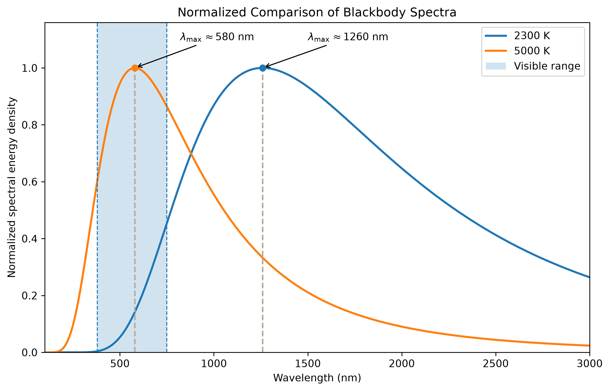
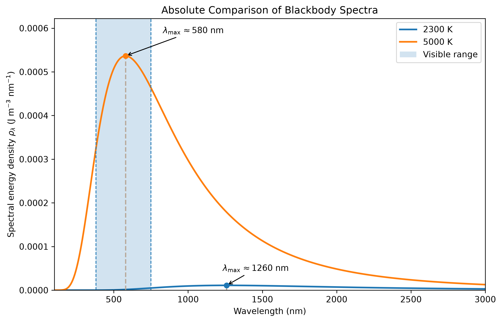

# HW1 Problem 3 — Blackbody radiation

`blackbody.py` compares blackbody spectra at 2300 K and 5000 K. The
calculation finds each peak wavelength, integrates the visible band, and
uses the visible fraction to estimate the light output of a simple lamp model.

## Planck spectrum and peak wavelength

Planck's law gives the energy density per unit wavelength, so
$\rho_\lambda(\lambda,T)\,d\lambda$ is the energy per unit volume in a
small wavelength interval.

```math
\rho_\lambda(\lambda,T)
=\frac{8\pi hc}{\lambda^5}\,
\frac{1}{\exp\!\left(hc/(\lambda k_B T)\right)-1}.
```

At fixed $T$, setting $x=hc/(\lambda k_B T)$ reduces the peak calculation
to maximizing $x^5/(\exp(x)-1)$. The maximizing $x>0$ satisfies
$5(1-\exp(-x))=x$, which gives Wien's displacement law
$\lambda_{\mathrm{max}}T\approx 2.898\times 10^{-3}\,\mathrm{m\,K}$.



This plot scales each spectrum by its own peak. The equal heights make
the shift easy to see. At 2300 K the peak is in the infrared. At 5000 K
it lies inside the shaded visible band.

## Visible fraction and absolute spectra

The visible band in this calculation is 380–750 nm. Integrating the
spectrum over that interval gives the visible energy density. The
Stefan–Boltzmann relation gives the full-spectrum energy density.

```math
u_{\mathrm{vis}}(T)=\int_{380\,\mathrm{nm}}^{750\,\mathrm{nm}}
  \rho_\lambda(\lambda,T)\,d\lambda,\qquad
u(T)=\frac{4\sigma}{c}T^4,\qquad
f_{\mathrm{vis}}(T)=\frac{u_{\mathrm{vis}}(T)}{u(T)}.
```



The two spectra now share a physical scale in joules per cubic metre
per nanometre. The area under each curve within the shaded band gives
its visible energy density. The hotter blackbody has more energy per
unit volume overall and a larger fraction of it in the visible band.

| Temperature | Peak wavelength | Visible energy density | Visible fraction |
| --- | ---: | ---: | ---: |
| 2300 K | 1259.9 nm | $6.561\times10^{-4}\,\mathrm{J\,m^{-3}}$ | 3.10% |
| 5000 K | 579.6 nm | $0.1804\,\mathrm{J\,m^{-3}}$ | 38.15% |

See the individual [2300 K spectrum](figs/01_spectrum_2300K.png) and
[5000 K spectrum](figs/02_spectrum_5000K.png) for separate views.

## Numerical checks

The script integrates from 1 nm to 1 cm in log wavelength. With
$y=\ln(\lambda/\lambda_0)$ and $\lambda_0=1\,\mathrm{m}$, the Jacobian is
$d\lambda=\lambda\,dy$.
The resulting totals agree with $4\sigma T^4/c$ to within
$4\times10^{-11}$ in relative error for both temperatures. The
numerically located peaks agree with Wien's law to within
$2\times10^{-6}$ in relative error.

## A simple lamp estimate

The outgoing spectral flux of an ideal blackbody is
$M_\lambda=(c/4)\rho_\lambda$, so the same fraction applies to its total
radiant power. If a 60 W incandescent lamp radiated all that power as a
2300 K blackbody, it would emit about $60\,\mathrm{W}\times0.0310=1.86\,\mathrm{W}$
of visible radiation. A 6 W LED would need to convert about 31% of its
electrical power into visible radiation to match that output. To compare
perceived brightness, one would also weight the two spectra by the eye's
wavelength sensitivity.

## Run

Run from the repository root.

```bash
uv run python hw01/p03_blackbody/blackbody.py
```

The script saves the four PNG files in the problem's `figs/` directory.
