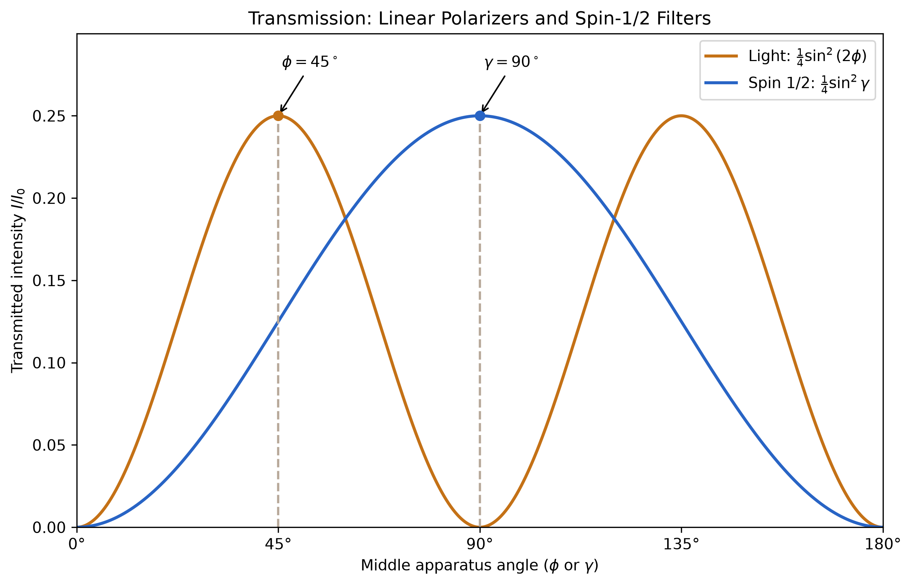
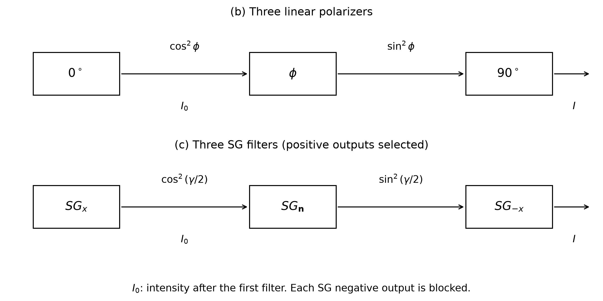

# HW3: three polarizers and three Stern-Gerlach filters



In both experiments, **$I_0$ is the intensity after the first filter**.
The graph therefore gives the fraction of this already prepared beam
that survives the remaining two devices. It does not include the loss
at the first device.

## (b) Linear polarization

The first polarizer has transmission axis $0^\circ$, the middle one $\phi$,
and the last one $90^\circ$. Malus's law gives the two successive transmission
factors:

```math
\frac{I}{I_0}
=\cos^2\phi\,\cos^2(90^\circ-\phi)
=\cos^2\phi\,\sin^2\phi
=\frac14\sin^2(2\phi).
```

Between the first and final axes ($0^\circ\le\phi\le90^\circ$), the optimum
is $\phi=45^\circ$, giving $I/I_0=1/4$. Continuing the middle polarizer to
$180^\circ$ also produces a maximum at $135^\circ$. A linear polarization
axis has no arrow: rotating it by $180^\circ$ describes the same polarizer.

## (c) Spin 1/2

The first device selects $\lvert S_x;+\rangle$. The middle measurement axis is
$\mathbf{n}=\cos\gamma\,\hat{\mathbf{x}}+\sin\gamma\,\hat{\mathbf{y}}$;
the last device selects $\lvert S_{-x};+\rangle$.
**Each SG device blocks its negative output.**

The angle between the middle and final axes is $\pi-\gamma$ for $0\le\gamma\le\pi$.
The spin-1/2 overlap rule gives:

```math
P_1=\cos^2\frac\gamma2,\qquad
P_{2\mid1}=\cos^2\frac{\pi-\gamma}{2}
=\sin^2\frac\gamma2.
```

Because the intermediate positive output is selected, the surviving state
is $\lvert S_{\mathbf{n}};+\rangle$. Multiply the successive conditional
probabilities:

```math
\frac{I}{I_0}=P_1P_{2\mid1}
=\cos^2\frac\gamma2\,\sin^2\frac\gamma2
=\frac14\sin^2\gamma.
```

The optimum is $\gamma=90^\circ$, giving $I/I_0=1/4$.

## Why the peak angles differ



The end filters select orthogonal states in both experiments. For light,
their physical axes differ by $90^\circ$; for spin 1/2, the selected positive
spin directions differ by $180^\circ$. Inserting an intermediate filter halfway
between the end axes makes each remaining transmission factor $1/2$.
Their product is $1/4$ in both cases.

Without the middle device, transmission is zero in both experiments.
The middle filter prepares a new state with a nonzero overlap with the
final selected state. The SG result assumes physical selection of the
positive branch; retaining or coherently recombining both branches is a
different experiment.

As a second comparison, define progress toward the final axis by
$t=\phi/90^\circ$ for light and $t=\gamma/180^\circ$ for SG. Both curves then
become $I/I_0=(1/4)\sin^2(\pi t)$, with a maximum at $t=1/2$. The figure uses
actual physical angles so the difference in optimum angles remains visible.

## Generate the figure

Run from the repository root.

```bash
uv run python hw03/spin_measurement/spin_measurement.py
# Optional interactive Matplotlib window:
uv run python hw03/spin_measurement/spin_measurement.py --show
```

The script saves `01_comparison` and `02_apparatus` in the problem's `figs/`
directory, each in PNG and editable SVG format.
