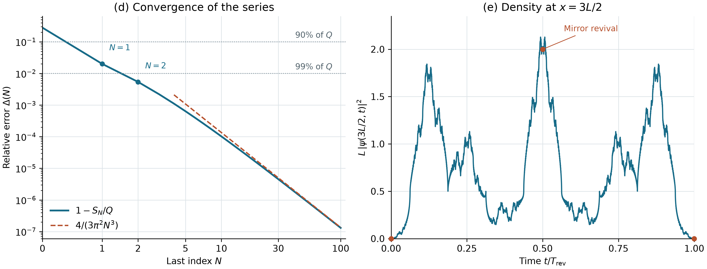

# HW4 Problem 1(d,e) — Sudden expansion of an infinite well



The particle starts in the ground state of the infinite well on $0<x<L$.
When the right wall suddenly moves to $2L$, the state at $t=0^+$ is
$\psi_0(x)=\sqrt{2/L}\,\sin(\pi x/L)$ on $0<x<L$, with zero amplitude
on $L\le x\le 2L$. The expanded well has normalized eigenfunctions
$\phi_j(x)=L^{-1/2}\sin(j\pi x/(2L))$ and energies
$E_j=j^2 E_1$, where $E_1=\pi^2\hbar^2/(8mL^2)$ and $j\ge 1$.

Projecting the initial state onto the new eigenfunctions gives

```math
c_j=\sqrt{2}\int_0^1 \sin(\pi u)\sin(j\pi u/2)\,du
=
\begin{cases}
1/\sqrt{2}, & j=2,\\
\dfrac{4\sqrt{2}\,\sin(j\pi/2)}{\pi(4-j^2)}, & j\ne 2.
\end{cases}
```

Here $u=x/L$. The case $j=2$ follows from integrating the square of a
sine, and the other cases follow from the product-to-sum identity. Only
the odd modes and $j=2$ contribute.

## (d) Convergence of the series

The $j=2$ mode carries half the norm. For the odd modes write $j=2n+1$
with $n\ge 0$. Then the other half gives

```math
\frac{1}{2}=\sum_{n=0}^{\infty}|c_{2n+1}|^2
=\frac{32}{\pi^2}Q,\qquad
Q=\sum_{n=0}^{\infty}\frac{1}{(4n^2+4n-3)^2}=\frac{\pi^2}{64}.
```

If $S_N$ includes terms $n=0$ through $n=N$, its relative remainder is
$\Delta(N)=1-S_N/Q$. Each term is asymptotic to $1/(16n^4)$, so the
tail has the leading behavior

```math
\Delta(N)\sim\frac{1}{Q}\int_N^\infty\frac{du}{16u^4}
=\frac{4}{3\pi^2N^3}.
```

The left panel retains $N=0$ and uses logarithmic spacing for $N\ge 1$.

| Fraction requested | First $N$ | Terms included | $S_N/Q$ |
| --- | ---: | ---: | ---: |
| 90% | 1 | 2 | 97.9888% |
| 99% | 2 | 3 | 99.4593% |

## (e) Density at the center of the new half

All phases return to unity at $T_{\mathrm{rev}}=2\pi\hbar/E_1=16mL^2/(\pi\hbar)$.
With $\tau=t/T_{\mathrm{rev}}$, sum the complex amplitudes at $x=3L/2$ and
then take the squared modulus to retain interference.

```math
L\lvert\psi(3L/2,t)\rvert^2=
\left|\sum_{j\ge 1}c_j\sin(3\pi j/4)e^{-2\pi i j^2\tau}\right|^2.
```

The density $\lvert\psi\rvert^2$ has units of inverse length. Multiplying by $L$
makes the right panel dimensionless. The density is zero here at $t=0$
and $T_{\mathrm{rev}}$. At half a period the mode phases are $(-1)^j$, while
reflecting $\phi_j(x)$ about $x=L$ multiplies it by $(-1)^{j+1}$.
The evolved state is therefore the reflected initial state up to a global
phase. Its scaled density at $3L/2$ is then $2$.

At $\tau=k/8$ for integer $k$, every odd $j$ has $j^2\equiv 1\pmod 8$.
At $x=3L/2$, the initial odd-mode amplitude cancels the $j=2$ amplitude,
whose value is $-1/\sqrt{2}$ in units of $1/\sqrt L$. At the eighths of
the period the odd amplitudes share the phase $e^{-2\pi i\tau}$, while
the $j=2$ phase is $e^{-8\pi i\tau}$. Their combined scaled density is
$1-\cos(6\pi\tau)$, giving $1+1/\sqrt{2}$ at $\tau=1/8$.

## Numerical resolution

The figure includes odd modes through $j=1023$, the $j=2$ mode, and
32,768 time intervals. The script reports how much the sampled density
changes when the largest odd mode increases to 2047 on the same grid.
To check time resolution, it holds the mode cutoff fixed and evaluates the
density at the midpoints of the plotted intervals. It compares those
values with linear interpolation of the plotted curve.

For the plotted settings, the largest changes in $L\lvert\psi\rvert^2$ are about
$4.1\times10^{-4}$ for the basis cutoff and $5.5\times10^{-3}$ for time
sampling. The full-period view shows the overall evolution. Resolving
the smallest, fastest oscillations can require a finer grid.

## Run

Run from the repository root.

```bash
uv run python hw04/p01_sudden_well_expansion/sudden_well_expansion.py
```

The script saves PNG and SVG figures in `figs/`. Add `--show` to open the
plot window.
